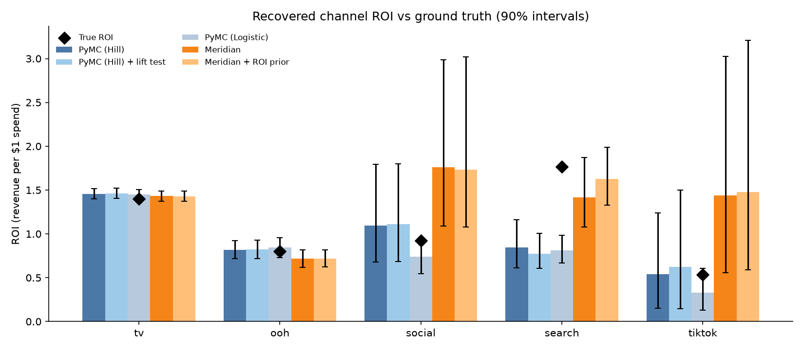
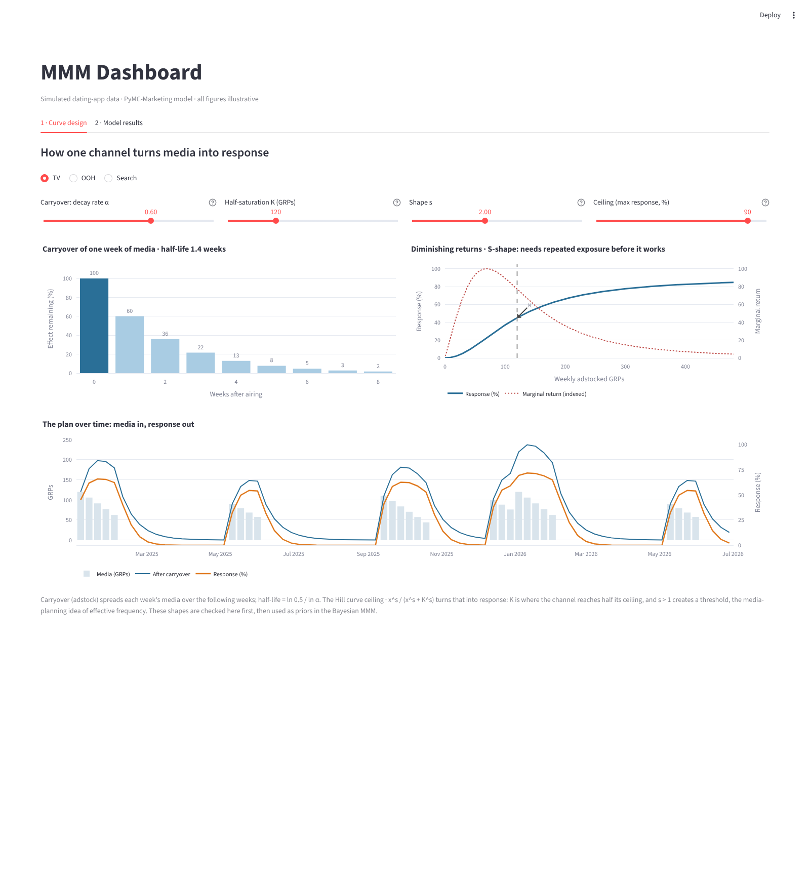
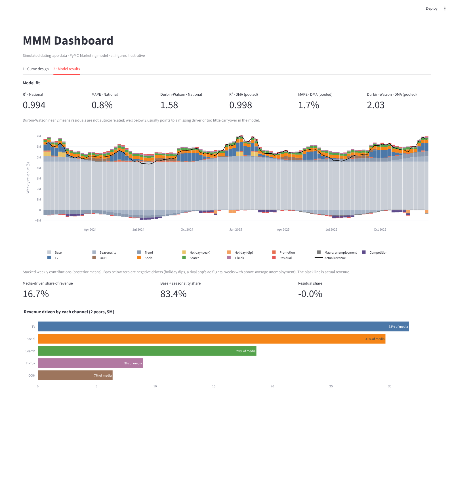

# Bayesian MMM: Google Meridian vs PyMC-Marketing

A side-by-side comparison of the two main open-source Bayesian Marketing Mix Modeling (MMM) packages,
[Google Meridian](https://github.com/google/meridian) and [PyMC-Marketing](https://github.com/pymc-labs/pymc-marketing),
plus a small dashboard showing how model outputs reach stakeholders.

Both packages are fit to the **same simulated dataset with a known ground truth**, so we can check what each
one recovers, how experiment calibration changes the answer, and how the choice of curve shape matters.

## 1. The simulated business

A subscription dating app advertises in **10 US DMAs for 104 weeks** across five channels.

```
revenue[dma, week] = baseline[dma, week]
                   + sum over channels of  beta[dma, channel] * Hill( Adstock(media) )
                   + noise
```

### Baseline drivers

| Driver | How it is simulated | How the models handle it |
|---|---|---|
| DMA level | Each DMA has its own revenue level (scaled by population) | A geo **dimension**: one intercept per DMA, not a regressor |
| Trend | +0.2% organic growth per week | PyMC: control variable · Meridian: time-varying baseline (knots) |
| Seasonality | Yearly cycle peaking in January (dating apps' busiest season) | PyMC: Fourier terms · Meridian: knots |
| Holidays | Peaks (New Year, Valentine's) and dips (Thanksgiving, Christmas) | Two holiday dummies |
| Promotions | Subscription discount in ~10% of weeks, DMA-specific | Dummy |
| Macro | Local unemployment rate; −2% revenue per +1 point | Continuous control |
| Competition | A rival app's media pressure in its own flights (offset from ours); −5% revenue at a typical burst | Continuous control |

Candidate drivers left out on purpose: **divorce rate** and similar annual statistics barely move within two
years, so they would be collinear with the trend and unidentifiable; **income or consumer-confidence** series
are highly correlated with unemployment, which stands in for the macro environment.

### Media: how each channel is bought and how it works

| Channel | Bought as | Flighting | Carryover (α, half-life) | Curve shape | Rationale |
|---|---|---|---|---|---|
| TV | GRPs (cost per point) | **Concentrated flights of 3–6 weeks** around January, Valentine's, spring and fall | 0.60 · 1.4 wk | **S-shape** (s = 2) | Long tail; needs repeated exposure before it works |
| OOH | Reach × frequency → GRPs | Two campaigns a year, 6–8 weeks | 0.20 · 0.4 wk | Mild S (s = 1.5) | Works mainly while the boards are up |
| Social | Impressions (CPM) | Always-on with a bi-annual rhythm | 0.30 · 0.6 wk | Mild S (s = 1.5) | Mix of brand and performance |
| Search | Impressions (CPM) | Always-on | 0.10 · 0.3 wk | **C-shape** (s = 1) | Captures existing demand, saturates fast |
| TikTok | Impressions (CPM) | Always-on | 0.25 · 0.5 wk | C-shape (s = 1) | Short-lived attention |

These are **assumptions informed by** industry sources, not benchmarks: TV is commonly scheduled in bursts
rather than continuously ([WARC](https://www.warc.com/en/article/continuity-or-burst%3F-how-do-tv-strategies-compare%3F-9b023c2205ac4567862c3eb396eb62db));
TV has a long tail while OOH and Search carry over less ([Recast](https://getrecast.com/adstock-rates/));
response to exposure frequency is often S-shaped, with a minimum frequency needed for recall
([Google Meridian docs](https://developers.google.com/meridian/docs/basics/reach-frequency)).

True ROI = total channel contribution / total spend (see `data/ground_truth.csv`):

| Channel | True ROI | Carryover α | Half-life (weeks) | Half-saturation K | Shape s |
|---|---|---|---|---|---|
| TV | 1.40 | 0.60 | 1.4 | 0.5 | 2.0 |
| OOH | 0.80 | 0.20 | 0.4 | 0.4 | 1.5 |
| Social | 0.92 | 0.30 | 0.6 | 0.4 | 1.5 |
| Search | 1.77 | 0.10 | 0.3 | 0.3 | 1.0 |
| TikTok | 0.53 | 0.25 | 0.5 | 0.6 | 1.0 |

### Experiments for calibration
- **Scale-up geo-lift test:** +30% Search spend in 3 DMAs gives the *marginal* revenue lift (`data/lift_test_search.csv`).
- **Go-dark holdout:** Search paused in test DMAs gives the *average* Search ROI (≈1.8), used as a Meridian ROI prior.

## 2. The two curves every MMM models

```
channel contribution = beta x Saturation( Adstock(media) )      <- nested, not multiplied
```

- **Adstock (carryover):** each week keeps a share **α** (decay or retention rate) of last week's effect.
  Half-life = ln 0.5 / ln α.
- **Saturation (diminishing returns), Hill curve:** `ceiling · x^s / (x^s + K^s)`.
  **K** is the half-saturation point: the media level where the channel reaches half its ceiling.
  **s** is the shape: s ≤ 1 gives a C-shaped curve (the first exposures work best); s > 1 gives an S-shape,
  where people need several exposures before they act. This is the media-planning idea of **effective
  frequency**. The **ceiling** is the most a channel can ever deliver, comparable to its maximum reach.
  For an S-shape, marginal return peaks at the inflection point `K · ((s−1)/(s+1))^(1/s)`, slightly below K.

### Same curves, different parameterizations

| | Media-planning terms | Google Meridian | PyMC-Marketing | Meta Robyn (reference, not fitted) |
|---|---|---|---|---|
| Media input | GRPs, impressions, clicks, reach × frequency, converted with CPM / CPP | Impressions or GRPs + spend; or reach + frequency | Any numeric column | Spend or exposure |
| Carryover | Half-life | `alpha_m`, prior Uniform(0, 1) | `alpha`, prior Beta(1, 3) by default; delayed and Weibull also available | Geometric `theta` or Weibull |
| Threshold / shape | Effective frequency | Hill `slope_m`, **fixed at 1 by default** for impression media | Hill `slope` (estimated), or Logistic (always concave) | Hill `alpha` |
| Half-saturation | Implied by effective frequency and reach | Hill `ec_m`, prior TruncatedNormal(0.8, 0.8) | Hill `kappa` | Hill `gamma` |
| Ceiling | Maximum reach | Implied by `roi_m` | `beta` | Coefficient |
| Estimation | | Bayesian (MCMC, TensorFlow Probability) | Bayesian (MCMC, PyMC) | Ridge regression + evolutionary search |

Meridian pins the Hill slope at 1 by default because slope and half-saturation are hard to identify separately.
We tried opening the TV slope (`--tv-slope`: LogNormal prior around 1.5, other channels held near 1) to allow an
S-shape. The sampler then stopped mixing (R-hat in the billions, identical draws across runs), which is exactly
what Meridian's own warning about changing `slope_m` anticipates. The main Meridian runs therefore keep the
default C-shape, while PyMC-Marketing estimates a Hill slope for every channel without trouble.

### PyMC-Marketing saturation options

| Function | Shape | When it helps |
|---|---|---|
| Logistic (default) | C only | Stable with little data |
| Hill | C or S | Channels with a frequency threshold; matches Meridian and Robyn |
| Michaelis-Menten | C only | Parameters read directly as ceiling and half-saturation |
| Tanh | C only | Prior can be set from a business-supplied initial CAC |
| Root, Log | C, no ceiling | Simple; Log + log link gives elasticities |

## 3. Model specifications in this repo

| | PyMC-Marketing (`src/fit_pymc.py`) | Meridian (`src/fit_meridian.py`) |
|---|---|---|
| Granularity | DMA × week, `dims=("geo",)` | DMA × week (native) |
| Media input | Spend for every channel | GRPs (TV, OOH) and impressions (digital), plus spend |
| Adstock | Geometric, `l_max=8`, channel-specific Beta priors (TV slow, Search fast) | Geometric, `max_lag=8` |
| Saturation | **Hill** (estimated K and slope per channel); Logistic variant for comparison | Hill with Meridian's default slope = 1 (C-shape) for all channels |
| DMA hierarchy | `beta[dma, channel] ~ LogNormal(mu[channel], sigma)` | Built in |
| Where priors go | Model parameters | **Directly on ROI** (`roi_m`) |
| Experiment calibration | Lift test as an **extra likelihood term** | Experiment result as an **ROI prior** |
| Budget optimizer | `mmm.budget_optimizer(...).allocate_budget(...)` | `BudgetOptimizer(mmm).optimize(...)` |

One hierarchical model is used across DMAs rather than one model per DMA: small DMAs have too little data on
their own, and partial pooling lets them borrow strength from the national estimate.

Both packages use **one adstock family and one saturation family for all channels** (with channel-specific
parameters). Mixing, say, delayed adstock for TV and geometric for Search would require custom model code.

Meridian can also take OOH as **reach and frequency** (`with_reach`) and estimate an optimal frequency.
That mode exceeded the 7 GB of RAM in the environment used here, so OOH enters Meridian as GRPs.

## 4. Results



Posterior mean ROI with 90% credible intervals (`results/roi_comparison.csv`):

| Channel | Truth | PyMC (Hill) | PyMC (Hill) + lift test | PyMC (Logistic) | Meridian | Meridian + ROI prior |
|---|---|---|---|---|---|---|
| TV | **1.40** | 1.46 [1.40, 1.51] | 1.46 [1.40, 1.52] | 1.45 [1.40, 1.50] | 1.43 [1.37, 1.49] | 1.43 [1.37, 1.49] |
| OOH | **0.80** | 0.82 [0.72, 0.92] | 0.82 [0.72, 0.93] | 0.85 [0.73, 0.96] | 0.72 [0.62, 0.82] | 0.72 [0.62, 0.82] |
| Social | **0.92** | 1.09 [0.68, 1.79] | 1.11 [0.69, 1.80] | 0.74 [0.55, 0.95] | 1.76 [1.09, 2.99] | 1.73 [1.08, 3.02] |
| Search | **1.77** | 0.84 [0.61, 1.16] | 0.77 [0.61, 1.00] | 0.81 [0.67, 0.98] | 1.42 [1.08, 1.87] | 1.63 [1.33, 1.99] |
| TikTok | **0.53** | 0.54 [0.15, 1.24] | 0.62 [0.15, 1.50] | 0.33 [0.13, 0.61] | 1.44 [0.56, 3.02] | 1.48 [0.59, 3.21] |
| Mean abs. error | | 0.24 | 0.27 | 0.29 | 0.44 | 0.40 |

**Diagnostics.** All three PyMC fits converged (max R-hat ≤ 1.01, no divergences). The Meridian fits reached
max R-hat 1.17 and 1.19 with 2 chains × 1,000 draws, above the usual 1.1 threshold, so their numbers are
indicative; longer chains would be the next step. PyMC (Hill) model fit: R² 0.994 and MAPE 0.8% nationally,
R² 0.998, MAPE 1.7% and Durbin-Watson 2.03 at DMA level (national DW 1.58 shows some leftover weekly
autocorrelation once DMAs are summed).

**What we learn**

1. **Flighted channels are easy, always-on channels are hard.** Every model recovers TV and OOH closely:
   their bursts create clean on/off variation. Always-on digital channels move together with the baseline,
   so their intervals are wide and the models disagree (Social, TikTok).
2. **Search is the hard case, and it shows the difference between average and marginal ROI.** Search's
   true response is C-shaped and already saturated at current spend: the *average* ROI is 1.77 but the
   next dollar returns much less. The +30% scale-up lift test measures that *marginal* effect, so adding it
   to PyMC does not lift the average-ROI estimate (0.84 → 0.77). A go-dark test measures *average* ROI;
   entering it as Meridian's ROI prior moves Search from 1.42 to 1.63, close to the truth.
   Calibration only helps if the experiment measures the same quantity the model reports.
3. **Curve shape matters for allocation more than for ROI.** Hill and Logistic give similar TV and OOH ROI,
   but Logistic cannot produce an S-shape, shrinks Social and TikTok, and changes the recommended budget.
4. **Meridian's fixed Hill slope.** With slope = 1 Meridian still gets TV's ROI right, but it cannot
   represent the frequency threshold, which matters for the shape of TV's response curve and so for planning.

**Budget reallocation** (same total, each channel within ±30%; `results/budget_*.csv`):

| Channel | PyMC (Hill) | PyMC + lift test | PyMC (Logistic) | Meridian | Meridian + ROI prior |
|---|---|---|---|---|---|
| TV | +30% | +30% | +30% | +30% | +30% |
| OOH | +1% | +1% | +15% | −30% | −30% |
| Social | −15% | −12% | −16% | 0% | −2% |
| Search | +11% | +7% | +8% | +3% | +6% |
| TikTok | −30% | −30% | −30% | −30% | −30% |

Every model agrees on the direction for the channels it measures well: move money from TikTok into TV, and
add some to Search. They split on OOH and Social, the channels with the most uncertain curves. That is where
a geo experiment would be worth running next. Meridian estimates the reallocation would raise incremental
revenue by about 3%.

## 5. From model to stakeholders

Meridian and PyMC-Marketing are modeling libraries, not products. They output posterior distributions,
tables and charts (Meridian can also write an HTML summary report), but no interface for marketers.
An in-house MMM wraps the model in four layers:

```
data pipeline  ->  model runs (per brand / market)  ->  stored posterior results  ->  UI
(spend, GRPs,      (Meridian or PyMC, scheduled)        (ROI, curves, decomposition)    (dashboard,
 KPIs, controls)                                                                         scenario planning)
```

`app/dashboard.py` is a small Streamlit version of that last layer:

1. **Curve design:** set carryover and saturation for a channel and see a single week's decay, the response
   curve with its marginal return, and how a flighting plan turns into response over time. These shapes are
   checked before modeling and inform the priors.
2. **Model results:** model fit (R², MAPE and Durbin-Watson at national and DMA level), the weekly revenue
   decomposition (base, seasonality, trend, holidays, promotion, macro, competition, each channel, residual)
   and revenue driven by each channel.




The same two views can be built as a **Hex** app: `hex/mmm_hex_app.ipynb` imports into Hex, where the
curve parameters become slider inputs and the notebook is published as an app (`hex/README.md`).

## 6. How to run

The two packages need different ArviZ versions, so use **two virtual environments**.

```bash
python -m venv .venv-pymc && .venv-pymc/bin/pip install -r requirements-pymc.txt
python -m venv .venv-meridian && .venv-meridian/bin/pip install -r requirements-meridian.txt
./run_all.sh                                   # simulate, fit all 5 variants, compare (~1 hour on CPU)
.venv-pymc/bin/streamlit run app/dashboard.py  # dashboard
```

Each fit script also accepts `--fast` for a quick smoke test.

## Repo structure

```
src/simulate.py      simulated DMA-level data, ground truth, lift test
src/fit_pymc.py      PyMC-Marketing: Hill or Logistic, lift-test calibration, decomposition, budget
src/fit_meridian.py  Meridian: ROI priors, TV slope prior, ROI / mROI, budget
src/compare.py       comparison table and chart
app/dashboard.py     Streamlit dashboard (curve design + model results)
hex/                 notebook and guide for running the dashboard in Hex
data/  results/      simulated data and model outputs
```
